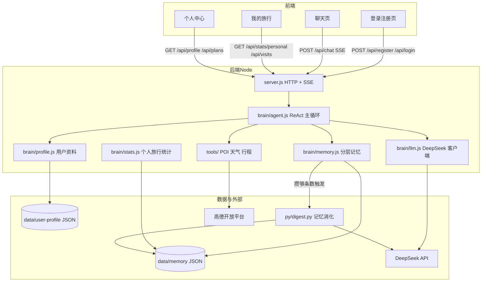

# 系统架构（途忆）

> 论文第 3 章素材。图用 mermaid 写成，VS Code / Typora 可直接预览，交论文时截图或转图片。

## 一、总体架构



## 二、模块职责

| 模块 | 职责 | 论文对应 |
|---|---|---|
| `server.js` | HTTP 服务、鉴权（含限流）、静态托管 React 构建产物、SSE 流式、行程 / 记忆 / 资料 / 统计接口 | 系统实现 |
| `brain/auth.js` | 本地账号（用户名 / 邮箱 / 手机，scrypt 哈希）、模拟验证码、会话（httpOnly cookie） | 系统实现 / 安全 |
| `brain/agent.js` | ReAct 主循环（≤6 步）：思考 → 工具 → 回喂 → 收尾；开轮注入人设 / 记忆块 / 用户资料、收尾写记忆 | 系统架构 / 提示工程 |
| `brain/llm.js` | DeepSeek 流式与非流式客户端、工具调用解析、JSON 容错解析 | 系统实现 |
| `brain/memory.js` | 分层记忆：对话轮次、事实抽取、去重、检索注入、消化触发；行程生命周期（草稿 → 确认 → 进行中 → 完成的状态机与连续修改） | 创新点（记忆消化 / 行程一致性） |
| `brain/stats.js` | 个人旅行统计：去过城市 / 次数 / 天数 / 预算、偏好标签（仅统计已确认行程） | 大数据元素 |
| `brain/profile.js` | 用户资料（称呼 / 年龄 / 性别 / 同行人 / 偏好标签 / 旅行风格 / 健康备注），白名单校验 + 来源标记，注入提示词 | 个性化 |
| `tools/` | 高德 POI（`search_poi`）、天气（`get_weather`）、行程生成与修改（`plan_trip`，mode=create/update）、读行程（`get_plan`）、改状态（`update_plan_status`）、记忆编辑（`memory_edit`，自动注册） | 数据接入 / 防幻觉 / 记忆可干预 |
| `py/digest.py` | 记忆消化：把零散事实反思合成为偏好标签 + 一句话认识 | 创新点 |
| `web/` | React + TypeScript + Ant Design 前端（Vite 构建，登录注册 / 聊天 / 我的旅行 / 个人中心，ECharts 地图点亮，小忆形象动效） | 系统功能与可视化 |
| `web/vendor/geo/` | 中国省 / 市级 GeoJSON（DataV GeoAtlas，离线可用） | 系统功能与可视化 |

## 三、一次对话的数据流

1. 前端 `POST /api/chat`（SSE，需登录，userId 取自 session）。
2. `runAgent` 读取用户记忆，把「偏好标签 + 相关历史」拼进 system 提示。
3. 模型流式输出；若发起 `tool_calls`，后端执行工具并把结果作为 `role:tool` 回喂。
4. 行程生成后调用 `plan_trip` 校验，通过则落库为**草稿**（状态机 draft → confirmed → in_progress → completed），向前端发 `itinerary` 事件，页面渲染卡片；用户确认后会计入个人统计与地图点亮。
5. 收尾：把本轮对话与「关于用户的事实」写入 `data/memory/<userId>.json`。
6. 记忆攒够条数 → 异步拉起 Python 消化，更新 `insights`；下一轮对话自动注入（连同 `data/user-profile/` 的用户资料）。

## 四、关键设计决策

1. **复用 Momo 的「大脑」**：Agent 主循环、工具注册、分层记忆、流式调用从 Momo 移植，去掉 QQ / 桌宠接入层。论文里可写「复用与改造」的边界（哪些直接复用、哪些重写）。
2. **Node 零 npm 依赖**：只用 Node 内置模块（http/fs/path/child_process）+ 全局 fetch；ECharts 本地化进 `web/vendor/`，答辩现场断网也能演示。
3. **记忆分层 + Python 分工**：Node 负责每轮轻量抽取（对话内、异步、不阻塞），Python 负责「攒够后反思合成」——独立脚本，便于单独测试与消融实验。
4. **防幻觉三层**：真实数据约束（POI / 天气）→ 结构化校验（plan_trip 固定 schema）→ 工具失败时诚实降级（`ok:false` 交给模型说明）。
5. **可解释统计**：意图与预算用规则分类（词表 + 金额分桶），论文里可解释、可复现；代价是覆盖不如模型分类。

## 五、目录结构（与代码一致）

```
tuyi/
├── server.js          # HTTP + SSE
├── brain/             # agent / llm / memory / stats / tools / env / prompts
├── tools/             # plan-trip / amap-poi / amap-weather（_amap 为共享库）
├── py/                # digest.py（记忆消化）
├── web/               # 三页 + vendor/echarts.min.js
├── test/              # smoke.js（离线）/ live.js（联网）
├── scripts/           # seed-demo.js / ablation.js
└── docs/              # plan / development / architecture / prompt-engineering / ablation / demo
```
